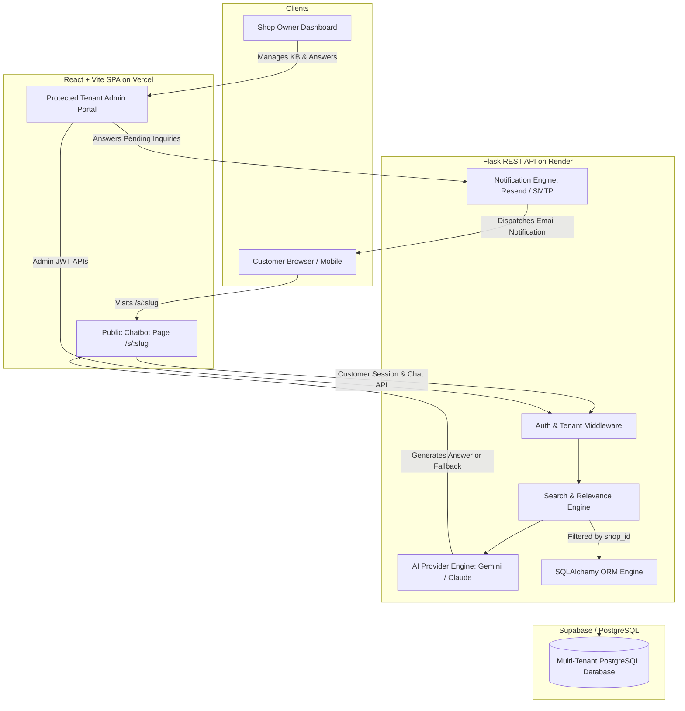
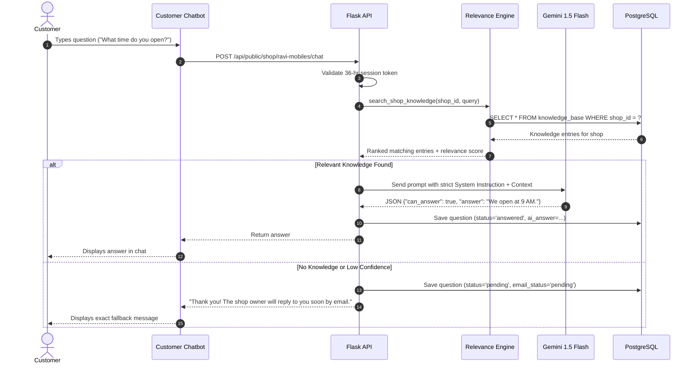

# System Architecture & Technical Specifications

## 1. High-Level Architecture Overview

Shop FAQ Bot is an enterprise-grade, multi-tenant SaaS platform that allows shop owners to provision customized AI-driven conversational assistants for their storefronts.

---

## 2. Multi-Tenant Isolation Strategy

Tenant isolation is built from the ground up at the database, business logic, and API gateway levels.

1. **Database-Level Isolation**:
   - Every tenant-specific table contains an indexed `shop_id` foreign key referencing `shops.id`.
   - All queries filter strictly by `shop_id`.
   - Cascading rules (`ondelete="CASCADE"`) guarantee that deleting a tenant purges all related sessions, messages, and knowledge without orphan leakages.

2. **Public Chatbot Slug Resolution**:
   - Customers never supply or control an internal database `shop_id`.
   - The backend validates the public URL slug (e.g., `/s/ravi-mobiles`), resolves the immutable internal `shop_id`, and validates session tokens against that specific `shop_id`.

3. **Admin JWT Token Validation**:
   - The JWT token contains `user_id` and `shop_id`.
   - The `@jwt_required` middleware validates the signature, queries the owner's shop, and assigns `g.current_shop`.
   - Admin routes only query `filter_by(shop_id=g.current_shop.id)`. Shop A can never read, modify, or delete Shop B's records.

---

## 3. AI Retrieval & Answering Pipeline

---

## 4. Continuous Self-Improvement Loop

When the AI encounters a question it cannot answer, or provides an answer the owner considers suboptimal:

1. **Pending Question Workflow**:
   - The owner answers the pending question in the admin portal.
   - The customer receives an email notification with the answer.
   - The system **automatically inserts** the question and approved answer into the knowledge base (`source_type = 'pending_answered'`).
   - Subsequent customer inquiries on that topic are answered immediately by the AI.

2. **Rate Answers & Correction Workflow**:
   - The owner rates an AI response as **Bad**.
   - The owner inputs *Why is it bad?* and *What is the right answer?*.
   - The system records negative feedback audit trails and inserts the corrected knowledge into the knowledge base (`source_type = 'feedback_correction'`).
   - The AI uses this corrected knowledge for all future retrieval queries.

