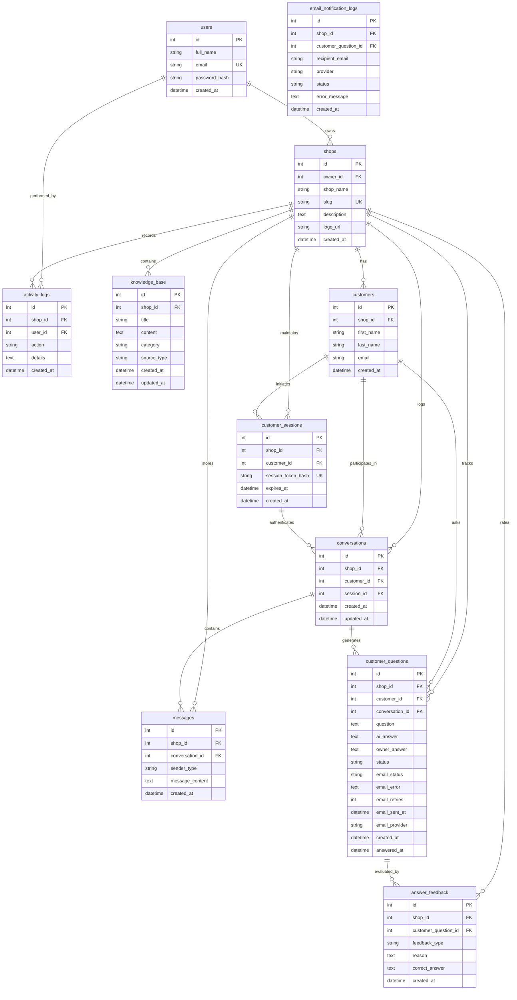

# Database Schema Documentation

## Entity Relationship Diagram (ERD)

---

## Detailed Table Specifications

### 1. `users`
Stores authenticated shop owner user credentials and account metadata.
- **`id`** (`INTEGER`, PRIMARY KEY, AUTOINCREMENT): Unique user identifier.
- **`full_name`** (`VARCHAR(120)`, NOT NULL): Full name of the shop owner.
- **`email`** (`VARCHAR(150)`, UNIQUE, NOT NULL, INDEXED): Login email address.
- **`password_hash`** (`VARCHAR(255)`, NOT NULL): Salted bcrypt password hash.
- **`created_at`** (`TIMESTAMP`, NOT NULL): Registration timestamp (UTC).

### 2. `shops`
Represents the tenant entity. Each shop owner owns a shop with a unique public URL slug.
- **`id`** (`INTEGER`, PRIMARY KEY, AUTOINCREMENT): Tenant identifier.
- **`owner_id`** (`INTEGER`, FOREIGN KEY -> `users.id`, ON DELETE CASCADE, NOT NULL): Owner reference.
- **`shop_name`** (`VARCHAR(150)`, NOT NULL): Display name of the shop.
- **`slug`** (`VARCHAR(100)`, UNIQUE, NOT NULL, INDEXED): URL slug for the public chatbot (e.g. `ravi-mobiles`).
- **`description`** (`TEXT`, NULLABLE): Business overview and services description.
- **`logo_url`** (`VARCHAR(500)`, NULLABLE): Optional URL to store logo.
- **`created_at`** (`TIMESTAMP`, NOT NULL): Creation timestamp (UTC).

### 3. `knowledge_base`
Stores shop-specific facts, policies, products, and FAQs used exclusively by the AI retrieval engine.
- **`id`** (`INTEGER`, PRIMARY KEY, AUTOINCREMENT): Knowledge entry ID.
- **`shop_id`** (`INTEGER`, FOREIGN KEY -> `shops.id`, ON DELETE CASCADE, NOT NULL, INDEXED): Tenant scoping key.
- **`title`** (`VARCHAR(200)`, NOT NULL, INDEXED): Title or topic summary.
- **`content`** (`TEXT`, NOT NULL): Full textual knowledge used for AI context injection.
- **`category`** (`VARCHAR(80)`, NOT NULL, INDEXED): Categorization tag (e.g. "Timings", "Products").
- **`source_type`** (`VARCHAR(50)`, NOT NULL, DEFAULT "manual"): Source provenance (`manual`, `pending_answered`, `feedback_correction`).
- **`created_at`** (`TIMESTAMP`, NOT NULL): Timestamp when entry was created.
- **`updated_at`** (`TIMESTAMP`, NOT NULL): Timestamp when entry was last modified.

### 4. `customers`
Stores customer records captured when visitors start a conversation on a shop's public chatbot.
- **`id`** (`INTEGER`, PRIMARY KEY, AUTOINCREMENT): Customer record ID.
- **`shop_id`** (`INTEGER`, FOREIGN KEY -> `shops.id`, ON DELETE CASCADE, NOT NULL, INDEXED): Tenant scoping key.
- **`first_name`** (`VARCHAR(80)`, NOT NULL): Customer first name.
- **`last_name`** (`VARCHAR(80)`, NOT NULL): Customer last name.
- **`email`** (`VARCHAR(150)`, NOT NULL, INDEXED): Customer contact email for notifications.
- **`created_at`** (`TIMESTAMP`, NOT NULL): Timestamp when customer was created.

### 5. `customer_sessions`
Manages customer session tokens valid for exactly 36 hours.
- **`id`** (`INTEGER`, PRIMARY KEY, AUTOINCREMENT): Session ID.
- **`shop_id`** (`INTEGER`, FOREIGN KEY -> `shops.id`, ON DELETE CASCADE, NOT NULL, INDEXED): Tenant scoping key.
- **`customer_id`** (`INTEGER`, FOREIGN KEY -> `customers.id`, ON DELETE CASCADE, NOT NULL, INDEXED): Customer reference.
- **`session_token_hash`** (`VARCHAR(128)`, UNIQUE, NOT NULL, INDEXED): SHA-256 hash of the random session token.
- **`expires_at`** (`TIMESTAMP`, NOT NULL, INDEXED): Absolute UTC timestamp when session expires (now + 36 hours).
- **`created_at`** (`TIMESTAMP`, NOT NULL): Timestamp when session was generated.

### 6. `conversations`
Groups chat sessions between a customer and the shop chatbot.
- **`id`** (`INTEGER`, PRIMARY KEY, AUTOINCREMENT): Conversation ID.
- **`shop_id`** (`INTEGER`, FOREIGN KEY -> `shops.id`, ON DELETE CASCADE, NOT NULL, INDEXED): Tenant key.
- **`customer_id`** (`INTEGER`, FOREIGN KEY -> `customers.id`, ON DELETE CASCADE, NOT NULL, INDEXED): Customer key.
- **`session_id`** (`INTEGER`, FOREIGN KEY -> `customer_sessions.id`, ON DELETE CASCADE, NOT NULL, INDEXED): Active session key.
- **`created_at`** (`TIMESTAMP`, NOT NULL): Initiation timestamp.
- **`updated_at`** (`TIMESTAMP`, NOT NULL): Last activity timestamp.

### 7. `messages`
Individual message records in a conversation.
- **`id`** (`INTEGER`, PRIMARY KEY, AUTOINCREMENT): Message ID.
- **`shop_id`** (`INTEGER`, FOREIGN KEY -> `shops.id`, ON DELETE CASCADE, NOT NULL, INDEXED): Tenant key.
- **`conversation_id`** (`INTEGER`, FOREIGN KEY -> `conversations.id`, ON DELETE CASCADE, NOT NULL, INDEXED): Conversation reference.
- **`sender_type`** (`VARCHAR(20)`, NOT NULL): Sender provenance (`customer`, `ai`, `owner`).
- **`message_content`** (`TEXT`, NOT NULL): Full message text.
- **`created_at`** (`TIMESTAMP`, NOT NULL): Timestamp when sent.

### 8. `customer_questions`
Tracks questions asked by customers and their lifecycle (Pending vs Answered).
- **`id`** (`INTEGER`, PRIMARY KEY, AUTOINCREMENT): Question ticket ID.
- **`shop_id`** (`INTEGER`, FOREIGN KEY -> `shops.id`, ON DELETE CASCADE, NOT NULL, INDEXED): Tenant key.
- **`customer_id`** (`INTEGER`, FOREIGN KEY -> `customers.id`, ON DELETE CASCADE, NOT NULL, INDEXED): Customer reference.
- **`conversation_id`** (`INTEGER`, FOREIGN KEY -> `conversations.id`, ON DELETE SET NULL, NULLABLE, INDEXED): Conversation reference.
- **`question`** (`TEXT`, NOT NULL): Customer's inquiry text.
- **`ai_answer`** (`TEXT`, NULLABLE): Generated AI answer (or NULL if insufficient knowledge).
- **`owner_answer`** (`TEXT`, NULLABLE): Answer provided directly by the shop owner.
- **`status`** (`VARCHAR(20)`, NOT NULL, DEFAULT "pending", INDEXED): Ticket status (`pending`, `answered`).
- **`email_status`** (`VARCHAR(30)`, NOT NULL, DEFAULT "not_applicable"): Notification status (`not_applicable`, `pending`, `sent`, `failed`).
- **`created_at`** (`TIMESTAMP`, NOT NULL): Question submission timestamp.
- **`answered_at`** (`TIMESTAMP`, NULLABLE): Timestamp when answer was submitted.

### 9. `answer_feedback`
Quality rating and reinforcement records submitted by shop owners for AI answers.
- **`id`** (`INTEGER`, PRIMARY KEY, AUTOINCREMENT): Feedback record ID.
- **`shop_id`** (`INTEGER`, FOREIGN KEY -> `shops.id`, ON DELETE CASCADE, NOT NULL, INDEXED): Tenant key.
- **`customer_question_id`** (`INTEGER`, FOREIGN KEY -> `customer_questions.id`, ON DELETE CASCADE, NOT NULL, INDEXED): Target question.
- **`feedback_type`** (`VARCHAR(10)`, NOT NULL): Rating (`good`, `bad`).
- **`reason`** (`TEXT`, NULLABLE): Explanation of why the AI answer was inaccurate or incomplete.
- **`correct_answer`** (`TEXT`, NULLABLE): Correct answer provided by the shop owner to update the knowledge base.
- **`created_at`** (`TIMESTAMP`, NOT NULL): Feedback timestamp.

### 10. `activity_logs`
Comprehensive audit trail for tenant administrative actions.
- **`id`** (`INTEGER`, PRIMARY KEY, AUTOINCREMENT): Log record ID.
- **`shop_id`** (`INTEGER`, FOREIGN KEY -> `shops.id`, ON DELETE CASCADE, NOT NULL, INDEXED): Tenant key.
- **`user_id`** (`INTEGER`, FOREIGN KEY -> `users.id`, ON DELETE SET NULL, NULLABLE, INDEXED): Acting owner user.
- **`action`** (`VARCHAR(100)`, NOT NULL): Action identifier (e.g. `knowledge_created`, `question_answered`, `feedback_bad_corrected`).
- **`details`** (`TEXT`, NULLABLE): Human-readable event description.
- **`created_at`** (`TIMESTAMP`, NOT NULL): Event timestamp.

